## Outline {.outline-slide}

- Log-logistic dose-response model
- Simulated data and estimation problem
- Gradient descent, damped Newton, and SGD
- Convergence and computation time
- Fitted dose-response curves

## Explanation of assignment {.explanation-slide}

- **Assume:** $Y_i = f(x_i \mid \alpha,\beta,\gamma,\delta) + \varepsilon_i$ with $\varepsilon_i \sim \mathcal{N}(0,\sigma^2)$ i.i.d., and

$$
f(x \mid \alpha,\beta,\gamma,\delta)
= \gamma + \frac{\delta - \gamma}{1 + \exp\{\beta\log(x) - \alpha\}},
\qquad \theta := (\alpha,\beta,\gamma,\delta)^{\mathsf T} \in \mathbb{R}^4
$$

- **Goal:** Use SGD to minimize the squared loss

$$
L(\theta) = \frac{1}{2N}\sum_{i=1}^{N}
\left(y_i - f(x_i \mid \alpha,\beta,\gamma,\delta)\right)^2
$$

and estimate the parameter $\theta$. 

We set $\theta_{\mathrm{true}} = (2.5,1.4,0.5,4.0)^{\mathsf{T}}$ as a benchmark.

## Implementation in R: Simulated data {.simulation-slide .implementation-slide}

::: {.simulation-explanation}
- Sample $Z_i$ uniformly, with replacement, from 15 equally spaced points in $[1,5]$; set $x_i=e^{Z_i}$.
- Generate $y_i=f(x_i\mid\theta_{\mathrm{true}})+\varepsilon_i$, with $\varepsilon_i\overset{\mathrm{iid}}{\sim}\mathcal{N}(0,\sigma^2)$.
:::

::: {.columns}
::: {.column width="45%"}

```r
dose_response <- function(x, theta) {
    alpha <- theta[1]
    beta <- theta[2]
    gamma <- theta[3]
    delta <- theta[4]
    gamma + (delta - gamma) * 
      plogis(alpha - beta * log(x))
  }

  sigma <- 0.25
  N <- 5000

  set.seed(123)
  log_grid <- seq(1, 5, length.out = 15)
  x <- exp(sample(log_grid, N, replace = TRUE))

  y <- dose_response(x, theta_true) +
    rnorm(N, mean = 0, sd = sigma)
```

:::
::: {.column width="55%"}

```{r}
#| echo: false
#| warning: false
#| message: false
#| fig-width: 7
#| fig-height: 5.2
#| out-width: "100%"
source("A4B_slideplots.R")
make_slide_data_plot(N = 1000, sigma = 0.25)
```

:::
:::

## Implementation in R: Loss function and gradient {.loss-gradient-slide .implementation-slide}

::: {.columns}
::: {.column width="52%"}

**Loss function**

$$
L(\theta) = \frac{1}{2N}\sum_{i=1}^{N}
\left(y_i - f(x_i \mid \theta)\right)^2
$$

**Gradient in terms of $p_i = (1 + \exp\{\beta\log(x_i) - \alpha\})^{-1}$**

$$
\begin{aligned}
\nabla L(\theta)
&= -\frac{1}{N}\sum_{i=1}^{N}
\mathrm{res}_i\,\nabla f(x_i \mid \theta) \\[1em]
&= -\frac{1}{N}\sum_{i=1}^{N}\mathrm{res}_i
\begin{pmatrix}
(\delta-\gamma)p_i(1-p_i) \\[0.4em]
-(\delta-\gamma)\log(x_i)p_i(1-p_i) \\[0.4em]
1-p_i \\[0.4em]
p_i
\end{pmatrix}.
\end{aligned}
$$

The components follow the order $\theta = (\alpha,\beta,\gamma,\delta)^{\mathsf T}$.

:::
::: {.column width="48%"}

<p aria-hidden="true">&nbsp;</p>

```r
loss_func <- function(theta, x, y) {
  residual <- y - dose_response(x, theta)
  sum(residual^2) / (2 * length(y))
}
```

<p aria-hidden="true">&nbsp;</p>

```r
gradient_func <- function(theta, x, y) {
  alpha <- theta[[1]]
  beta  <- theta[[2]]
  gamma <- theta[[3]]
  delta <- theta[[4]]
  
  lx <- log(x)
  p <- plogis(alpha - beta * lx)
  q <- p * (1 - p)
  residual <- y - (gamma + (delta - gamma) * p)
  rq <- residual * q

  -c(
    (delta - gamma) * sum(rq),
    -(delta - gamma) * sum(rq * lx),
    sum(residual * (1 - p)),
    sum(residual * p)
  ) / length(y)
}
```

:::
:::

## Implementation in R: Stochastic Gradient Descent {.sgd-slide .implementation-slide}

::: {.sgd-intro}
Learning rate motivated by Robbins–Monro
:::

::: {.columns}
::: {.column width="48%"}

$$
\gamma_n = \frac{\gamma_0 K}{K+n^a} \sim \gamma_0 K n^{-a}.
$$

For $\tfrac12<a\leq1$,

$$
\sum_{n=1}^{\infty}\gamma_n=\infty,
\qquad
\sum_{n=1}^{\infty}\gamma_n^2<\infty.
$$

The theorem requires **strong convexity** of the risk $\mathbb{E}[L(\theta)]$. Our risk is not globally convex ([see appendix](#risk-nonconvexity)).

:::
::: {.column width="52%"}

```r
sgd <- function(theta_init, x, y, grad, tol = 1e-4,
                gamma_0 = 0.5, K = 100, a = 0.9,
                batch_size = 100, max_epochs = 500,
                cb = NULL) {
  theta <- theta_init
  n <- length(y)
  step <- 0
  if (!is.null(cb)) cb() # Record initial theta

  for (epoch in seq_len(max_epochs)) {
    shuffled_idx <- sample.int(n)

    for (start in seq.int(1, n, by = batch_size)) {
      step <- step + 1
      learning_rate <- gamma_0 * K / (K + step^a)
      batch_idx <- shuffled_idx[
        start:min(start + batch_size - 1L, n)
      ]
      batch_grad <- grad(theta, x[batch_idx], y[batch_idx])

      theta <- theta - learning_rate * batch_grad
    }
    if (!is.null(cb)) cb()

  }
  list(theta = theta)
}
```

:::
:::


```{r}
#| include: false
source("4B_correctnesscheck.R")
```

## Implementation in R: Correctness check {.correctness-slide .implementation-slide}

::: {.columns}
::: {.column width="48%"}

Generate **noiseless data** from $\theta_{\mathrm{true}} = (2.5, 1.4, 0.5, 4)^{\mathsf{T}}$, with $N = 10{,}000$.

Compare **squared parameter errors** before and after SGD:

Before: $\|\theta_{\mathrm{true}}-\theta_0\|_2^2$; after: $\|\theta_{\mathrm{true}}-\hat\theta\|_2^2$.

```{r}
#| echo: false
#| results: asis
cat(readLines("Pictures/sgd-correctness-results.md"), sep = "\n")
```

This is a numerical sanity check; finite SGD runs need not recover the parameters exactly.

:::
::: {.column width="52%"}

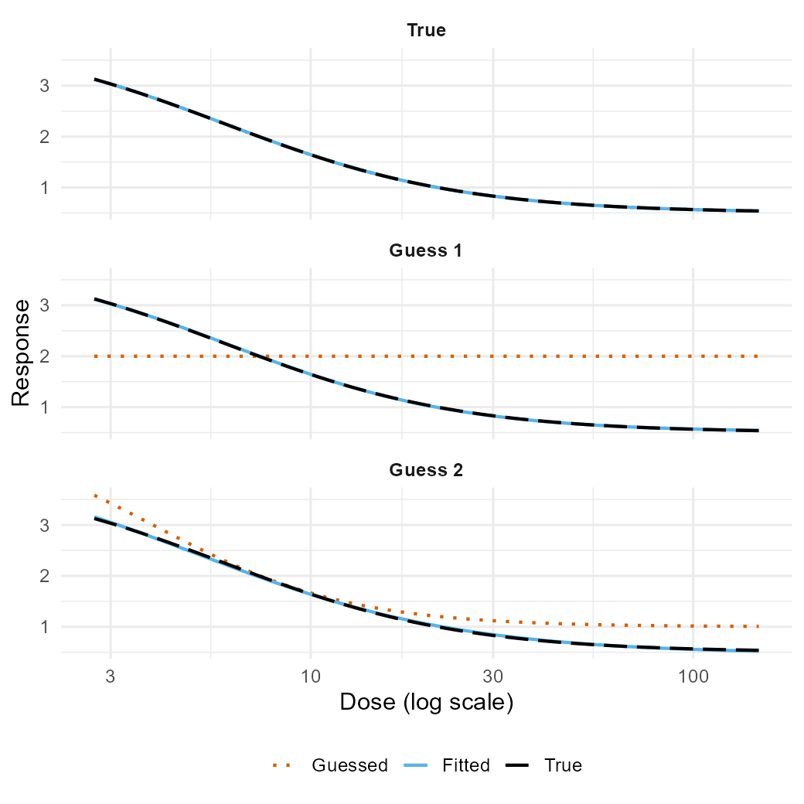{width=100% .nostretch fig-alt="Dose-response curves starting at the truth and each of the two guesses in the table. Each panel compares the guessed and SGD-fitted curves with the true curve."}

:::
:::

::: {.sgd-parameters}
SGD: $\gamma_0 = 0.5$, $K = 100$, $a = 0.9$; batch size 100; 100 epochs. Seed 123 for data and batch shuffling. Results regenerate when rendering.
:::

## Finding the SGD parameters

To model $\theta$ using SGD different parameters must be studied.

- **Learning rate** 
- **Different seeds**
- **Starting points**
- **Mini-batch size** 

These will be inspected in the following. 

Two problems:

1. Can not visualize 4 parameters at a time. 
   - We initially keep $\gamma,\delta$ fixed and only vary $\alpha,\beta$

2. When sampling from $\theta_{\mathrm{true}} = (2.5, 1.4, 0.5, 4.0)$ these will not be the optimal parameters in the sample.
   - We use a Damped Newton with tolerance of $10^{-12}$ to find $\hat{\theta}$
   - Find parameters $\hat{\theta}=(2.509440, 1.405544, 0.5, 4)$
   - These will be used as the 'true' theta in the sample.


## Choice of a and K

For intial learning rate $\gamma_0=0.01$

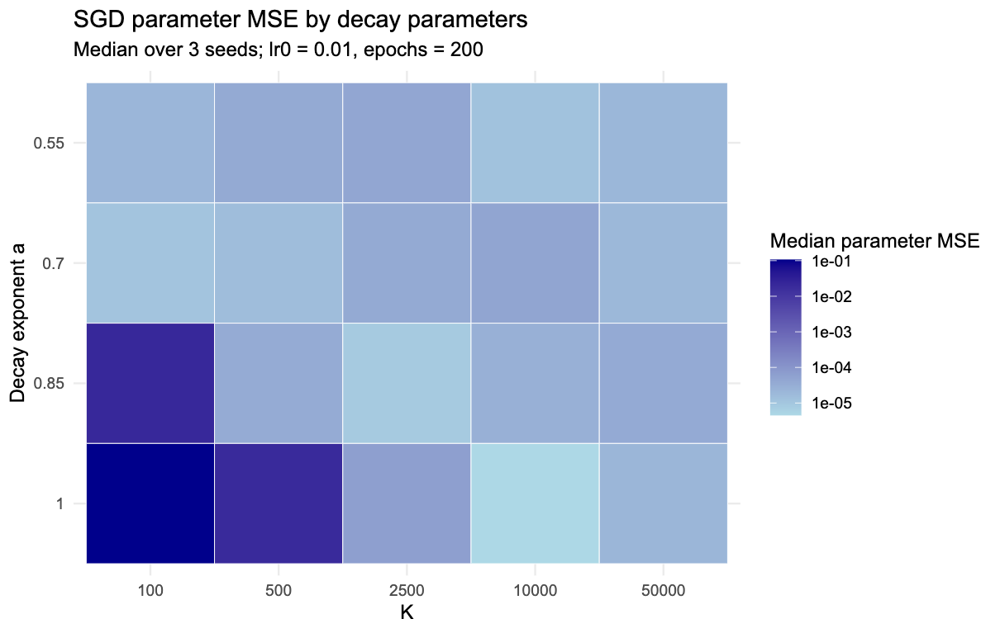{width=80%}

## Choice of a and K

For intial learning rate $\gamma_0=0.5$

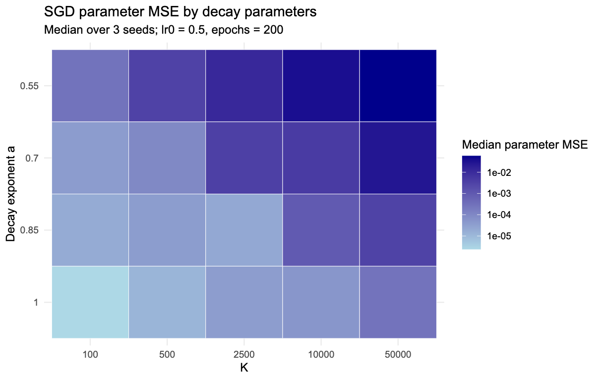{width=80%}

## Choice of a and K

For intial learning rate $\gamma_0=3$

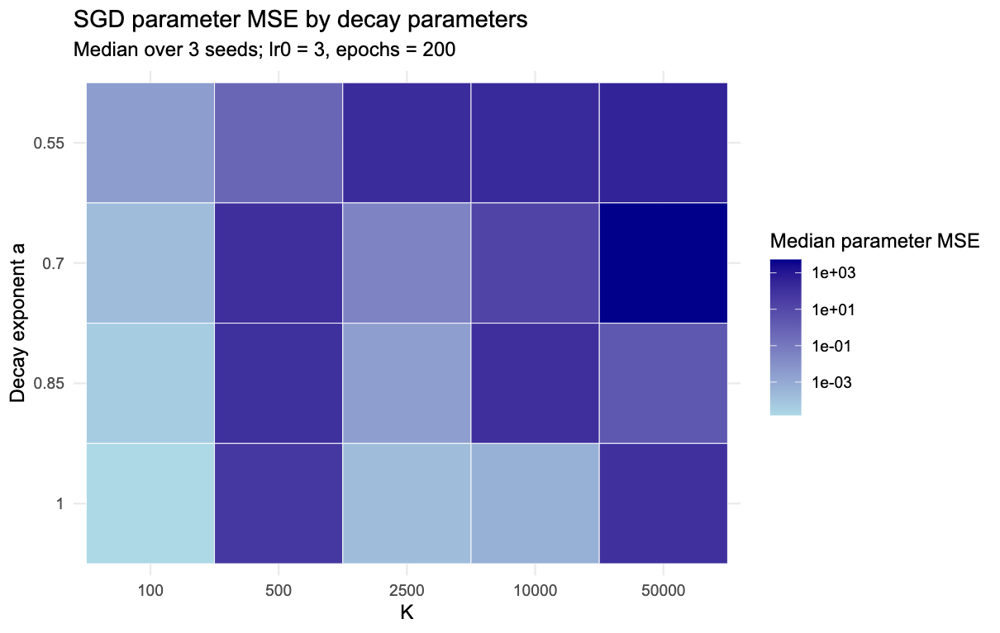{width=80%}

It seems that setting $a=1$ and $K=10,000$ is somewhat resonable for different initial learning rates.


## Choice of initial learning rate $\gamma_0$, MSE

::: {.columns}

::: {.column width="50%"}
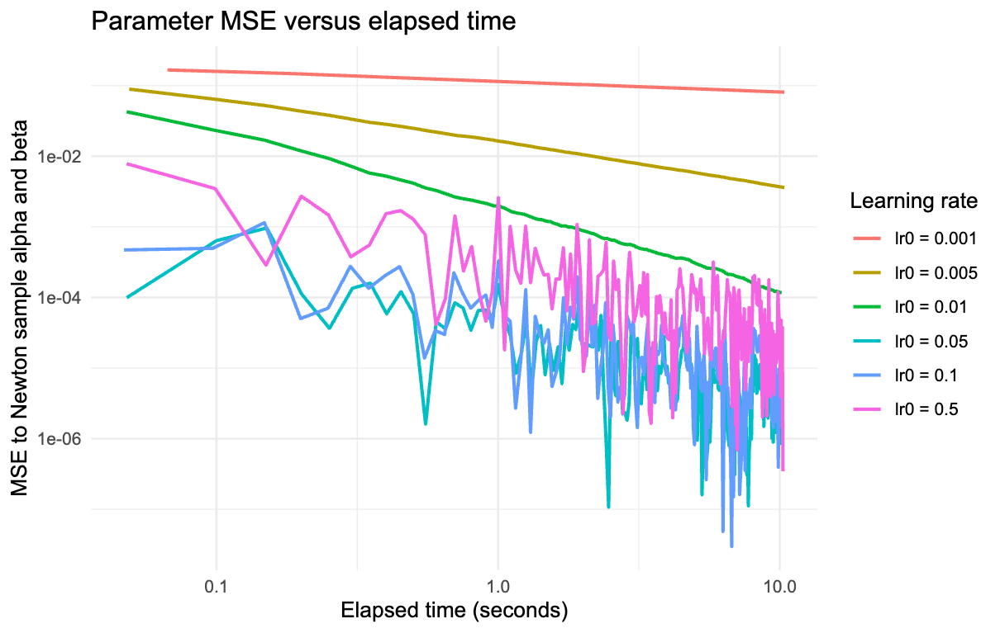{width=100%}
:::

::: {.column width="50%"}
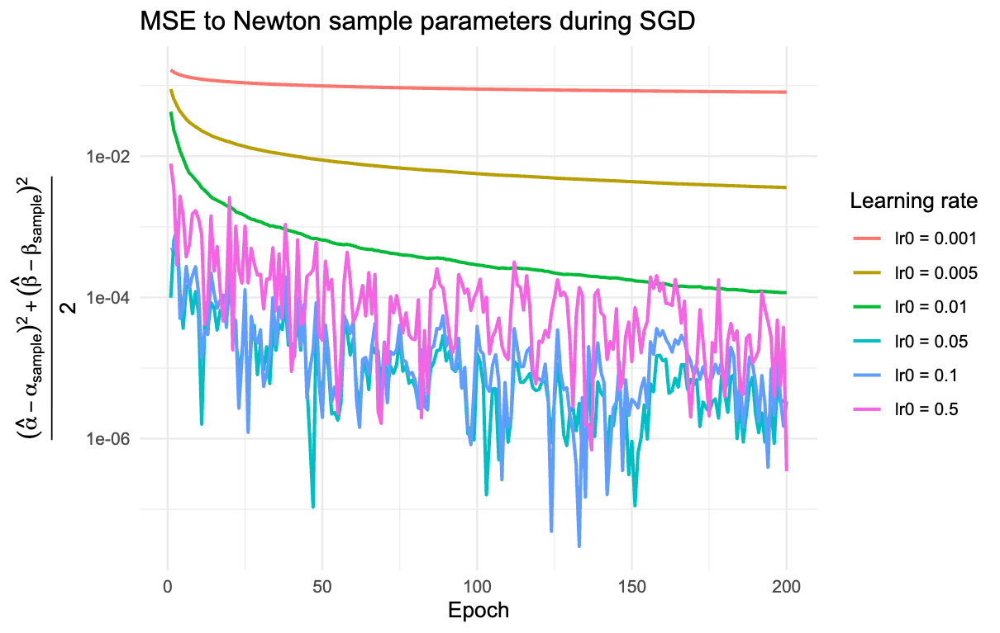{width=100%}
:::

:::

Too small value of $\gamma_0$ makes convergence very slow, but large values seems to make the results very random.


## Choice of initial learning rate $\gamma_0$, Path-plot

::: {.columns}

::: {.column width="50%"}
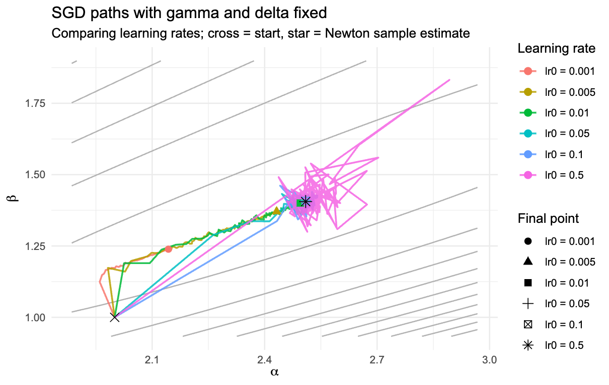{width=100%}
:::

::: {.column width="50%"}
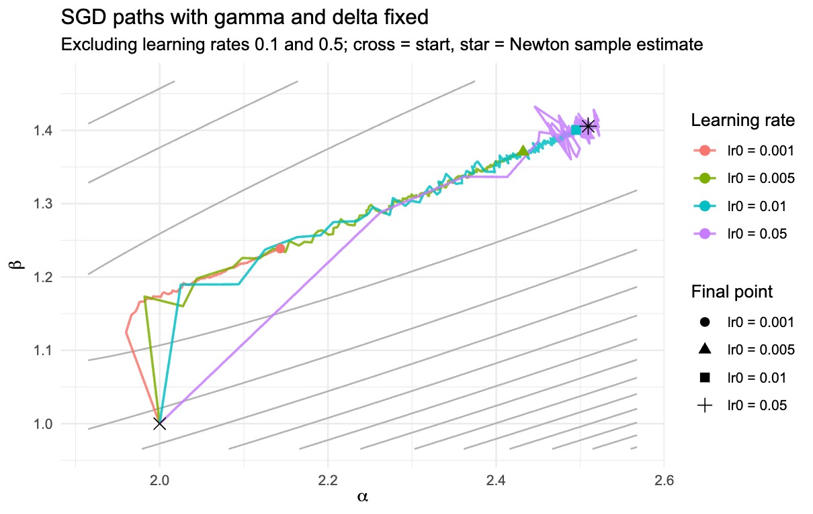{width=100%}
:::

:::

Taking $\gamma_0$ too large seems to make it jump all over the place. Having $\gamma_0$ too little makes it not converge at all. A value in between is probably to prefer.

## Different seeds for the SGD

We try different seeds to see if we randomly ends in local minima and not the global minimum.

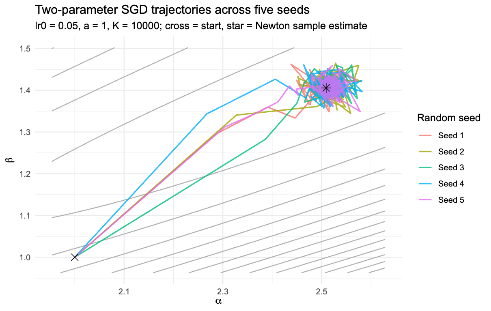{width=100%}

It seems that all five seeds converge to the same minima. They all had the same starting point though. If chaning this effets the minima is also to be explored.

## Different initial guesses

Trying different starting guesses on the parameters $(\alpha,\beta)$ also shows how robust the SDG is:

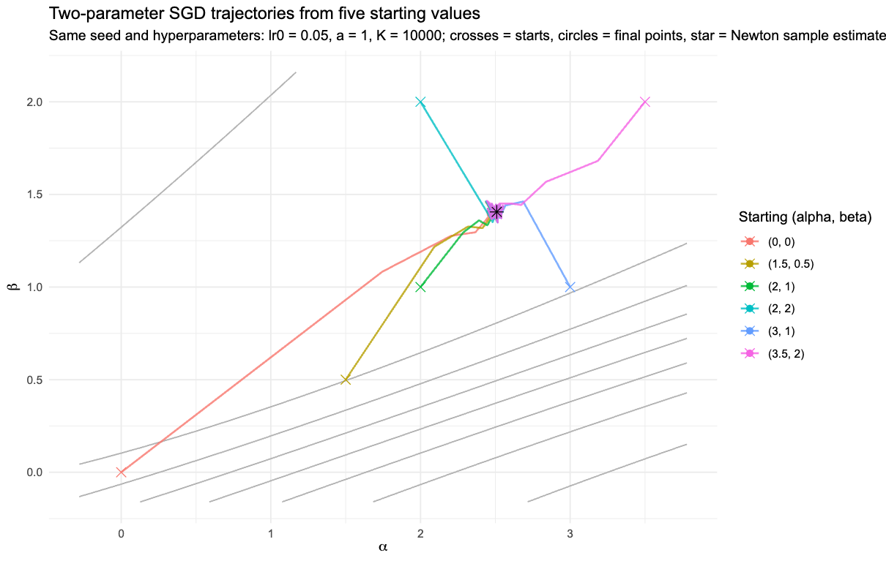{width=100%}

Changing the starting guess on $(\alpha,\beta)$ also seems to be robust. 

This could indicate that the optimization problem is well-behaved. Even though the problem is not convex.


## Mini-batches in stochastic gradient descent {.sgd-slide}

Instead of using all observations at every step, we update the parameters from a random subset of the data:

$$
\theta_{n+1}
=
\theta_n
-
\gamma_t
\frac{1}{|I_n|}
\sum_{i \in I_n}
\nabla L_i(\theta_n),
$$

where $B_t$ is a mini-batch of observations.

- Full batch:
  - uses all data each iteration
  - stable but computationally expensive

- Stochastic gradient descent:
  - uses one observation at a time
  - very noisy but cheap

- Mini-batch SGD:
  - uses a small subset of observations
  - balances speed and stability (less variance than single-sample SGD but faster updates than full-batch GD)
  - often works best in practice

This is especially useful for large datasets, where computing the full gradient is slow or memory-heavy.

## Mini-batches paths

We study how the number of batches effect the path.

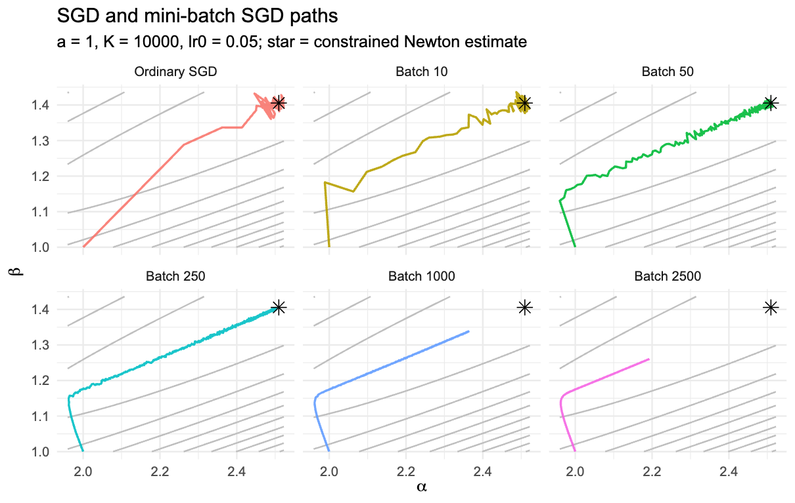{width=100%}

It is clear, that having more batches leads to a more stabile result, but the congergence becomes more time-consuming. 


## Mini-batches convergence

::: {.columns}

::: {.column width="50%"}
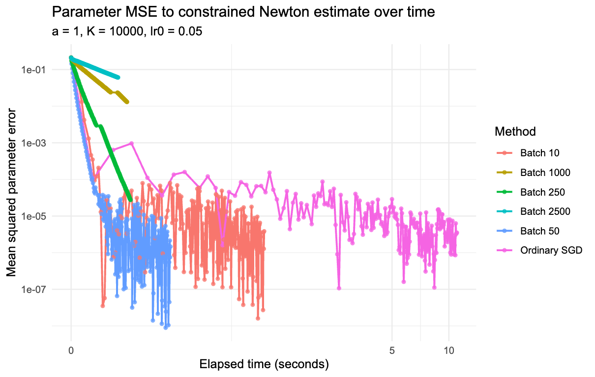{width=100%}
:::

::: {.column width="50%"}
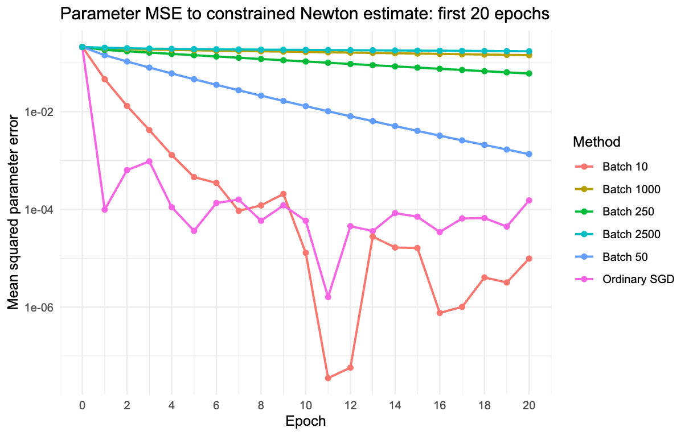{width=100%}
:::

:::

Having many batches gives one more stabile results, but the convergence takes many more epochs and time. The fastest (in time) to get to the tolerance of $10^{-5}$ seems to be for batch size 50. So having batches seems to help. 


## Comparing SGD with GD and Newton

We compare how SGD, SGD with mini-batches, GD and Damped Newton each converge towards the true $\theta$-value. 


Comparison of optimization methods

- GD uses the full gradient at every iteration. Its updates are stable, but each iteration becomes more expensive as the sample size increases.
- SGD uses one observation per update. This makes updates cheap, but the optimization path is noisy.
- Mini-batch SGD balances these effects: larger batches give smoother updates, while smaller batches make cheaper, noisier updates.
- Damped Newton can converge quickly near a solution, but each iteration is more computationally expensive and its performance may depend strongly on the starting value.


## Comparing SGD with GD and Newton

::: {.columns}

::: {.column width="50%"}
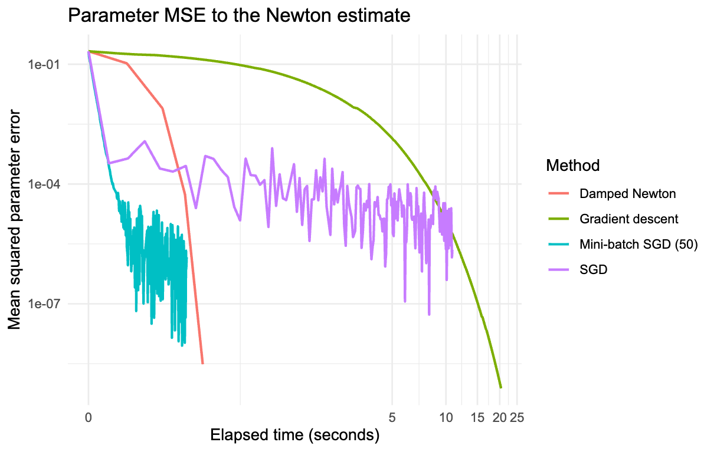{width=100%}
:::

::: {.column width="50%"}
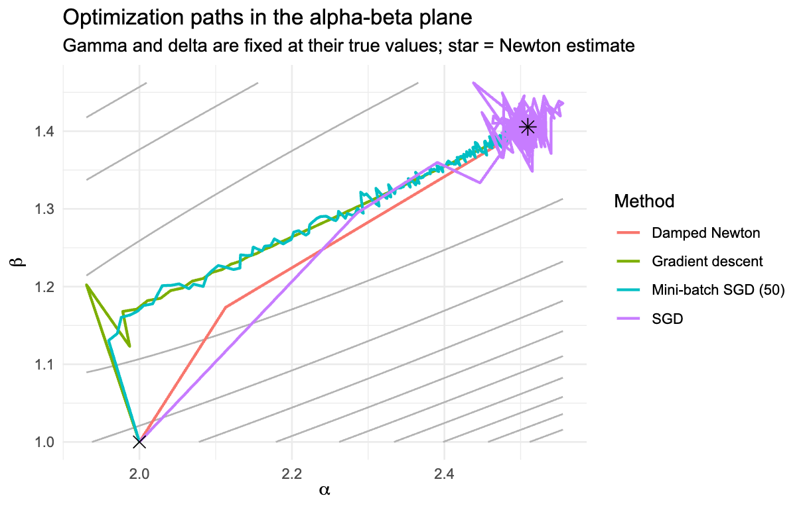{width=100%}
:::

:::

From the above plots, it is clear that mini-batches leads to the fastes convergence for a tolerance of $10^{-6}$. Newton and GD are best for when the tolerance is very low. But especially GD is very slow. If a very precise tolerance is not needed, SGD works just fine, with a very fast convergence. 


Now, let us instead move from only looking on $(\alpha,\beta)$ to optimize all four parameters at a time.


## Optimizer comparison {.comparison-slide}

::: {.columns}
::: {.column width="48%"}

We compare **SGD** with **gradient descent (GD)**, and **damped Newton** with backtracking:

| Setting | GD | Damped Newton |
|:--|--:|--:|
| Restart step $\gamma_0$ | $1$ | $1$ |
| Armijo constant $c$ | $0.05$ | $0.05$ |
| Reduction factor $d$ | $0.5$ | $0.5$ |
| Maximum iterations | $600$ | $100$ |
| Gradient tolerance | $10^{-4}$ | $10^{-4}$ |

Stop when $\|\nabla L(\theta)\|_2$ reaches the tolerance, or at the iteration cap. The step size restarts at $\gamma_0$ each iteration.

:::
::: {.column width="52%"}

**Newton direction and gradient fallback**

Let $g_k = \nabla L(\theta_k)$ and $H_k = \nabla^2 L(\theta_k)$.
The Newton direction is $p_k^{\mathrm N} = -H_k^{-1}g_k$.

A direction is a **descent direction** if $g_k^{\mathsf T}p_k < 0$. We use

$$
p_k =
\begin{cases}
p_k^{\mathrm N}, & g_k^{\mathsf T}p_k^{\mathrm N} < 0, \\[0.4em]
-g_k, & g_k^{\mathsf T}p_k^{\mathrm N} \geq 0.
\end{cases}
$$

The fallback guarantees $g_k^{\mathsf T}(-g_k) = -\|g_k\|_2^2 < 0$ when $g_k \neq 0$.
Armijo backtracking then chooses $\gamma_k$ for $\theta_{k+1} = \theta_k + \gamma_k p_k$.

:::
:::

## Performance comparison: Varying $N$ and batch size {.performance-slide .performance-grid-slide}

True parameters: $\theta_{\mathrm{true}} = (2.5, 1.4, 0.5, 4.0)^{\mathsf T}$; starting guess: $\theta_0 = (3, 2, 2, 5)^{\mathsf T}$. Every update traced:

<!-- Regenerate both grids by sourcing A4_performanceplots.R separately. -->

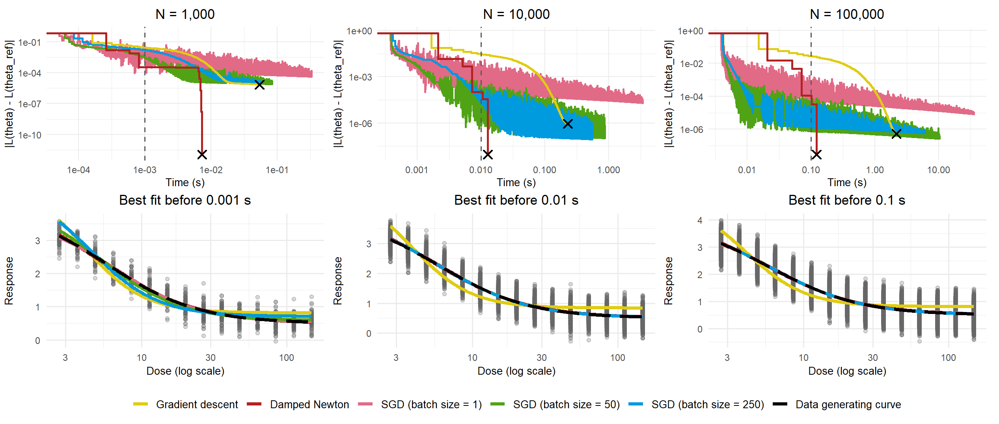{.nostretch .performance-grid-image width=100% fig-align="center" fig-alt="Six plots for the good starting guess: convergence above fitted curves, with sample sizes 1,000, 10,000, and 100,000 in columns. Fits use the best recorded theta before 0.001, 0.01, and 0.1 seconds, respectively."}

::: {.sgd-parameters}
Curves use $\theta$ that minimize $|L(\theta) - L(\theta_{\mathrm{ref}})|$ before time (dashed line). Black X: converged.

SGD: $\gamma_0 = 0.5$, $K = 100$, $a = 0.9$; max epochs $(100, 500, 500)$ for batches $(1, 50, 250)$. Stops at the epoch cap.
:::

## Performance comparison: Varying $N$ and batch size {#performance-comparison-alternative .performance-slide .performance-grid-slide}

True parameters: $\theta_{\mathrm{true}} = (2.5, 1.4, 0.5, 4.0)^{\mathsf T}$; starting guess: $\theta_0 = (1, 4, 0, 2)^{\mathsf T}$. Every update traced:

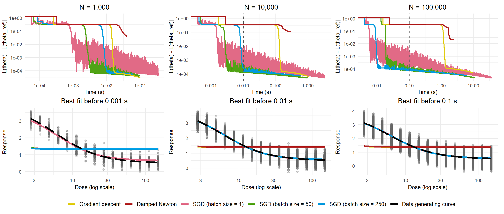{.nostretch .performance-grid-image width=100% fig-align="center" fig-alt="Six plots for the poor starting guess: convergence above fitted curves, with sample sizes 1,000, 10,000, and 100,000 in columns. Fits use the best recorded theta before 0.001, 0.01, and 0.1 seconds, respectively."}

::: {.sgd-parameters}
Curves use $\theta$ that minimize $|L(\theta) - L(\theta_{\mathrm{ref}})|$ before time (dashed line). Black X: converged.

SGD: $\gamma_0 = 0.5$, $K = 100$, $a = 0.9$; max epochs $(100, 500, 500)$ for batches $(1, 50, 250)$. Stops at the epoch cap.
:::

## Performance comparison: Varying $\gamma_0$ {#performance-comparison-learning-rates .performance-slide .performance-grid-slide}

$\theta_{\mathrm{true}} = (2.5, 1.4, 0.5, 4.0)^{\mathsf T}$, $N=10{,}000$:

<!-- Regenerate this grid by sourcing 4B_updatetracedperformanceplots.R separately. -->

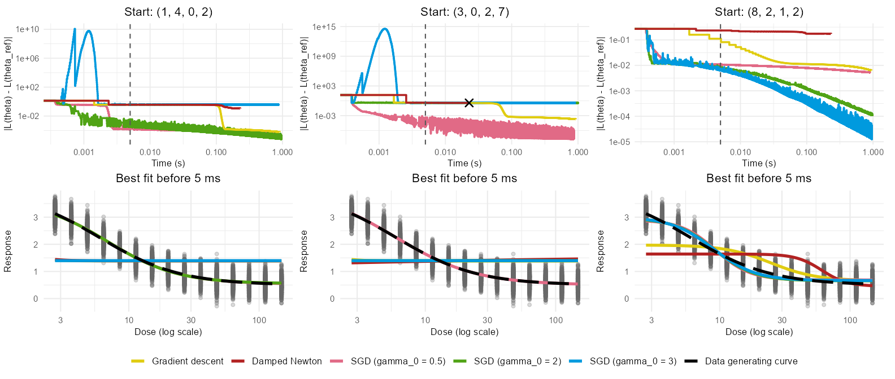{.nostretch .performance-grid-image width=100% fig-align="center" fig-alt="Six learning-rate comparison plots from starting guesses (1, 4, 0, 2), (3, 0, 2, 7), and (8, 2, 1, 2). Convergence plots above fitted dose-response curves compare GD, damped Newton, and SGD with initial learning rates 0.5, 2, and 3. Each fitted curve uses its algorithm's best recorded parameters strictly before 5 ms, marked by a dashed line."}

::: {.sgd-parameters}
Curves use $\theta$ that minimize $|L(\theta)-L(\theta_{\mathrm{ref}})|$ strictly before **5 ms** (dashed line). Black X: converged.

SGD: $\gamma_0\in\{0.5,2,3\}$, $K=100$, $a=0.9$; batch size 50; 500 epochs. Every update traced.
:::

## Appendix: The risk is not convex {#risk-nonconvexity .convexity-appendix}

For $Y=f(X\mid\theta_{\mathrm{true}})+\varepsilon$, with $\mathbb{E}[\varepsilon\mid X]=0$ and $\operatorname{Var}(\varepsilon\mid X)=\sigma^2$,

$$
R(\theta):=\mathbb{E}[L(\theta)]
=\frac{\sigma^2}{2}
+\frac12
\bigl(f(X\mid\theta)-f(X\mid\theta_{\mathrm{true}})\bigr)^2.
$$

::: {.columns}
::: {.column width="48%"}

**Example**

$$
\theta(t)=(t,1.4,0.5,4),\qquad
r(t)=R(\theta(t))-\frac{\sigma^2}{2}.
$$

If $R$ were convex, its restriction $r$ would satisfy the **midpoint inequality**.

:::
::: {.column width="52%"}

**Midpoint counterexample**

```{r}
#| echo: false
#| results: asis
appendix_log_doses <- seq(1, 5, length.out = 15)
appendix_response <- function(alpha) {
  0.5 + 3.5 * plogis(alpha - 1.4 * appendix_log_doses)
}
appendix_alpha <- c(2.5, 10, 17.5)
appendix_risk <- vapply(appendix_alpha, function(alpha) {
  mean((appendix_response(alpha) - appendix_response(2.5))^2) / 2
}, numeric(1))
cat(c("| $t$ | $r(t)$ |", "|--:|--:|",
      sprintf("| %.1f | %.4f |", appendix_alpha, appendix_risk)), sep = "\n")
```

Since $10=(2.5+17.5)/2$, convexity would require

$$
r(10)\leq\frac{r(2.5)+r(17.5)}{2}.
$$

Instead, $`r sprintf("%.4f", appendix_risk[2])` > `r sprintf("%.4f", mean(appendix_risk[c(1, 3)]))`$.

:::
:::

