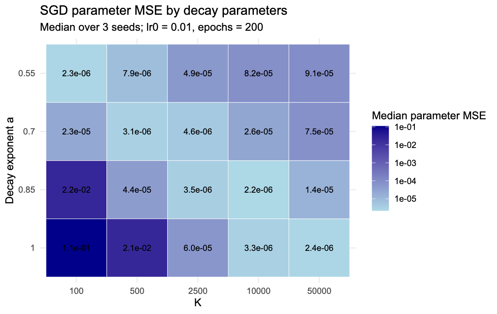

## Outline {.outline-slide}

- Log-logistic dose-response model
- Simulated data and estimation problem
- Gradient descent, damped Newton, and SGD
- Convergence and computation time
- Fitted dose-response curves

## Explanation of assignment {.explanation-slide}

- **Assume:** $Y_i = f(x_i \mid \alpha,\beta,\gamma,\delta) + \varepsilon_i$ with $\varepsilon_i \sim \mathcal{N}(0,\sigma^2)$ i.i.d., and

$$
f(x \mid \alpha,\beta,\gamma,\delta)
= \gamma + \frac{\delta - \gamma}{1 + \exp\{\beta\log(x) - \alpha\}},
\qquad \theta := (\alpha,\beta,\gamma,\delta) \in \mathbb{R}^4
$$

- **Goal:** Use SGD to minimize the squared loss

$$
L(\theta) = \frac{1}{2N}\sum_{i=1}^{N}
\left(y_i - f(x_i \mid \alpha,\beta,\gamma,\delta)\right)^2
$$

and estimate the parameter $\theta$. 

We set $\theta_{\mathrm{true}} = (2.5,1.4,0.5,4.0)^{\mathsf{T}}$ as a benchmark.

## Implementation in R: Simulated data {.simulation-slide}

::: {.columns}
::: {.column width="45%"}

```r
dose_response <- function(x, theta) {
    alpha <- theta[1]
    beta <- theta[2]
    gamma <- theta[3]
    delta <- theta[4]
    gamma + (delta - gamma) * 
      plogis(alpha - beta * log(x))
  }

  sigma <- 0.25
  N <- 5000

  set.seed(123)
  log_grid <- seq(1, 5, length.out = 15)
  x <- exp(sample(log_grid, N, replace = TRUE))

  y <- dose_response(x, theta_true) +
    rnorm(N, mean = 0, sd = sigma)
```

:::
::: {.column width="55%"}

```{r}
#| echo: false
#| warning: false
#| message: false
#| fig-width: 7
#| fig-height: 5.2
#| out-width: "100%"
source("A4B_slideplots.R")
make_slide_data_plot(N = 1000, sigma = 0.25)
```

:::
:::

## Implementation in R: Loss function and gradient {.loss-gradient-slide}

::: {.columns}
::: {.column width="52%"}

**Loss function**

$$
L(\theta) = \frac{1}{2N}\sum_{i=1}^{N}
\left(y_i - f(x_i \mid \theta)\right)^2
$$

**Gradient in terms of $p_i = (1 + \exp\{\beta\log(x_i) - \alpha\})^{-1}$**

$$
\begin{aligned}
\nabla L(\theta)
&= -\frac{1}{N}\sum_{i=1}^{N}
\mathrm{res}_i\,\nabla f(x_i \mid \theta) \\[1em]
&= -\frac{1}{N}\sum_{i=1}^{N}\mathrm{res}_i
\begin{pmatrix}
(\delta-\gamma)p_i(1-p_i) \\[0.4em]
-(\delta-\gamma)\log(x_i)p_i(1-p_i) \\[0.4em]
1-p_i \\[0.4em]
p_i
\end{pmatrix}.
\end{aligned}
$$

The components follow the order $\theta = (\alpha,\beta,\gamma,\delta)^{\mathsf T}$.

:::
::: {.column width="48%"}

<p aria-hidden="true">&nbsp;</p>

```r
loss_func <- function(theta, x, y) {
  residual <- y - dose_response(x, theta)
  sum(residual^2) / (2 * length(y))
}
```

<p aria-hidden="true">&nbsp;</p>

```r
gradient_func <- function(theta, x, y) {
  alpha <- theta[[1]]
  beta  <- theta[[2]]
  gamma <- theta[[3]]
  delta <- theta[[4]]
  
  lx <- log(x)
  p <- plogis(alpha - beta * lx)
  q <- p * (1 - p)
  residual <- y - (gamma + (delta - gamma) * p)
  rq <- residual * q

  -c(
    (delta - gamma) * sum(rq),
    -(delta - gamma) * sum(rq * lx),
    sum(residual * (1 - p)),
    sum(residual * p)
  ) / length(y)
}
```

:::
:::

## Implementation in R: Stochastic Gradient Descent {.sgd-slide}

::: {.sgd-intro}
Learning rate: Robins Monro suggests
:::

::: {.columns}
::: {.column width="48%"}

$$
\gamma_n = \gamma_0 K / (K n^\alpha)
$$

But $f$ is not even convex on $\mathbb{R}^4$ ...

Checking e.g. strong convexity of $\mathbb{E}[L(\theta)]$? 

Probably not.

:::
::: {.column width="52%"}

```r
sgd <- function(theta_init, x, y, grad, tol = 1e-4,
                gamma_0 = 0.5, K = 100, a = 0.9,
                batch_size = 100, max_epochs = 500,
                cb = NULL) {
  theta <- theta_init
  n <- length(y)
  step <- 0
  if (!is.null(cb)) cb() # Record initial theta

  for (epoch in seq_len(max_epochs)) {
    shuffled_idx <- sample.int(n)

    for (start in seq.int(1, n, by = batch_size)) {
      step <- step + 1
      learning_rate <- gamma_0 * K / (K + step^a)
      batch_idx <- shuffled_idx[
        start:min(start + batch_size - 1L, n)
      ]
      batch_grad <- grad(theta, x[batch_idx], y[batch_idx])

      theta <- theta - learning_rate * batch_grad
    }
    if (!is.null(cb)) cb()

  }
  list(theta = theta)
}
```

:::
:::


## Finding the SGD parameters

To model $\theta$ using SGD different parameters must be studied.

- **Learning rate** 
- **Different seeds**
- **Starting points**
- **Mini-batch size** 

These will be inspected in the following. 

Two problems:

1. Can not visualize 4 parameters at a time. 
   - We initially keep $\gamma,\delta$ fixed and only vary $\alpha,\beta$

2. When sampling from $\theta_{\mathrm{true}} = (2.5, 1.4, 0.5, 4.0)$ these will not be the optimal parameters in the sample.
   - We use a Damped Newton with tolerance of $10^{-12}$ to find $\hat{\theta}$
   - Find parameters $\hat{\theta}=(2.509440, 1.405544, 0.5, 4)$
   - These will be used at the 'true' theta in the sample.


## Choice of a and K

{width=80%}


## Optimizer comparison {.comparison-slide}

- Compare **SGD**, **gradient descent (GD)**, and **damped Newton** on the same data, using the same initial parameters.
- GD and damped Newton use **Armijo backtracking**, restarting at $\gamma_0 = 1.0$, with $c = 0.05$ and step reduction factor $d = 0.5$.
- Both stop when $\|\nabla L(\theta)\|_2 \leq 10^{-4}$, or when their iteration limit is reached.
- Compare sample sizes $N = 1{,}000$, $10{,}000$, and $100{,}000$; set the random seed to 123 for reproducibility.

## Performance comparison: Good start guess {.performance-slide .performance-grid-slide}

True parameters: $\theta_{\mathrm{true}} = (2.5, 1.4, 0.5, 4.0)^{\mathsf T}$; starting guess: $\theta_0 = (3, 2, 2, 5)^{\mathsf T}$.

```{r}
#| label: performance-comparisons
#| include: false
#| cache: true
#| cache.lazy: false
#| cache.extra: !expr tools::md5sum(c("A4_comparefuncs.R", "A4_performanceplots.R"))
source("A4_performanceplots.R")
```

```{r}
#| label: performance-grid-good
#| cache: false
#| echo: false
#| warning: false
#| message: false
#| fig-width: 13.2
#| fig-height: 5.6
#| out-width: "100%"
#| fig-align: center
#| fig-alt: "Six plots for the good starting guess: convergence above fitted curves, with sample sizes 1,000, 10,000, and 100,000 in columns. Fits use the best recorded theta before 0.001, 0.01, and 0.1 seconds, respectively."
library(dplyr)
make_performance_grid <- function(comparisons) {
  sample_sizes <- c("1,000", "10,000", "100,000")
  time_limits <- c(0.001, 0.01, 0.1)
  early_comparisons <- Map(best_curves_before_time, comparisons, time_limits)
  convergence_plots <- lapply(seq_along(comparisons), function(i) {
    comparisons[[i]]$convergence_plot +
      ggplot2::labs(title = paste("N =", sample_sizes[i]), x = "Time (s)") +
      ggplot2::geom_vline(
        xintercept = time_limits[i], color = "grey35", linetype = "dashed",
        linewidth = 0.6, show.legend = FALSE
      ) +
      ggplot2::guides(color = "none")
  })
  curve_plots <- lapply(seq_along(early_comparisons), function(i) {
    early_comparisons[[i]]$curve_plot +
      ggplot2::labs(title = paste("Best fit before", time_limits[i], "s")) +
      ggplot2::guides(
        color = ggplot2::guide_legend(nrow = 1),
        linetype = ggplot2::guide_legend(nrow = 1)
      )
  })
  patchwork::wrap_plots(
    c(convergence_plots, curve_plots), ncol = 3, nrow = 2,
    byrow = TRUE, guides = "collect"
  ) &
      ggplot2::theme(
        plot.title = ggplot2::element_text(size = 13, hjust = 0.5),
        axis.title = ggplot2::element_text(size = 10),
        axis.text = ggplot2::element_text(size = 9),
        legend.position = "bottom",
        legend.title = ggplot2::element_blank(),
        legend.text = ggplot2::element_text(size = 10),
        plot.margin = ggplot2::margin(4, 6, 2, 2)
      )
}
make_performance_grid(list(comparison_1000, comparison_10000, comparison_100000))
```

::: {.sgd-parameters}
Curves minimize $|L(\theta) - L(\theta_{\mathrm{ref}})|$ before the dashed line. Black X: converged GD/Newton.

SGD: $\gamma_0 = `r formals(sgd)$gamma_0`$, $K = `r formals(sgd)$K`$, $a = `r formals(sgd)$a`$; max epochs $(`r paste(comparison_1000$sgd_settings$max_epochs, collapse = ", ")`)$ for batches $(`r paste(comparison_1000$sgd_settings$batch_size, collapse = ", ")`)$; tolerance $= `r sprintf("%g", formals(sgd)$tol)`$.
:::

## Performance comparison: Poor start guess {#performance-comparison-alternative .performance-slide .performance-grid-slide}

True parameters: $\theta_{\mathrm{true}} = (2.5, 1.4, 0.5, 4.0)^{\mathsf T}$; starting guess: $\theta_0 = (1, 4, 0, 2)^{\mathsf T}$.

```{r}
#| label: performance-grid-poor
#| cache: false
#| echo: false
#| warning: false
#| message: false
#| fig-width: 13.2
#| fig-height: 5.6
#| out-width: "100%"
#| fig-align: center
#| fig-alt: "Six plots for the poor starting guess: convergence above fitted curves, with sample sizes 1,000, 10,000, and 100,000 in columns. Fits use the best recorded theta before 0.001, 0.01, and 0.1 seconds, respectively."
make_performance_grid(list(
  comparison_1000_p2, comparison_10000_p2, comparison_100000_p2
))
```

::: {.sgd-parameters}
Curves minimize $|L(\theta) - L(\theta_{\mathrm{ref}})|$ before the dashed line. Black X: converged GD/Newton.

SGD: $\gamma_0 = `r formals(sgd)$gamma_0`$, $K = `r formals(sgd)$K`$, $a = `r formals(sgd)$a`$; max epochs $(`r paste(comparison_1000_p2$sgd_settings$max_epochs, collapse = ", ")`)$ for batches $(`r paste(comparison_1000_p2$sgd_settings$batch_size, collapse = ", ")`)$; tolerance $= `r sprintf("%g", formals(sgd)$tol)`$.
:::

## Performance comparison: Update tracing {.performance-slide .performance-grid-slide}

$N = 1{,}000$; true parameters: $\theta_{\mathrm{true}} = (2.5, 1.4, 0.5, 4.0)^{\mathsf T}$.

```{r}
#| label: update-traced-comparisons
#| include: false
#| cache: true
#| cache.lazy: false
#| cache.extra: !expr tools::md5sum(c("A4_comparefuncs.R", "4B_updatetracedperformanceplots.R"))
source("4B_updatetracedperformanceplots.R")
```

```{r}
#| label: performance-grid-update-traced
#| cache: false
#| echo: false
#| warning: false
#| message: false
#| fig-width: 13.2
#| fig-height: 5.6
#| out-width: "100%"
#| fig-align: center
#| fig-alt: "Update-traced optimization with N = 1,000 in a 2 by 2 grid. The good starting guess is on the left and the poor starting guess on the right. Convergence is above fitted curves using each algorithm's best recorded theta strictly before 5 milliseconds."
update_traced_marked_grid <- update_traced_performance_grid
for (i in 1:2) {
  update_traced_marked_grid[[i]] <- update_traced_marked_grid[[i]] +
    ggplot2::geom_vline(
      xintercept = 0.005, color = "grey35", linetype = "dashed",
      linewidth = 0.6, show.legend = FALSE
    )
}
grid::grid.newpage()
grid::grid.draw(patchwork::patchworkGrob(update_traced_marked_grid))
```

::: {.sgd-parameters}
SGD is traced after every update. Curve cutoff: $5\,\mathrm{ms}$. Black X: converged GD/Newton.

SGD: $\gamma_0 = `r formals(sgd_update_traced)$gamma_0`$, $K = `r formals(sgd_update_traced)$K`$, $a = `r formals(sgd_update_traced)$a`$; max epochs $(`r paste(update_traced_comparisons[[1]]$sgd_settings$max_epochs, collapse = ", ")`)$ for batches $(`r paste(update_traced_comparisons[[1]]$sgd_settings$batch_size, collapse = ", ")`)$; tolerance $= `r sprintf("%g", formals(sgd_update_traced)$tol)`$.
:::
